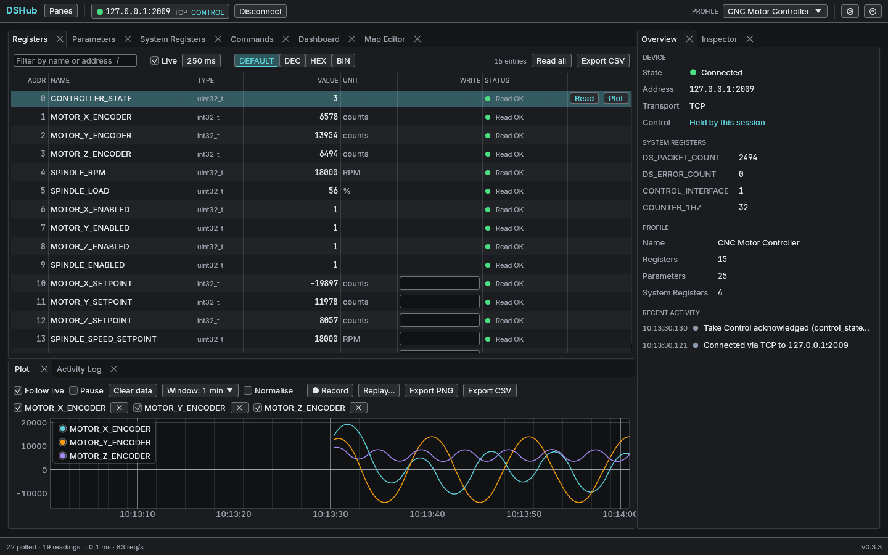
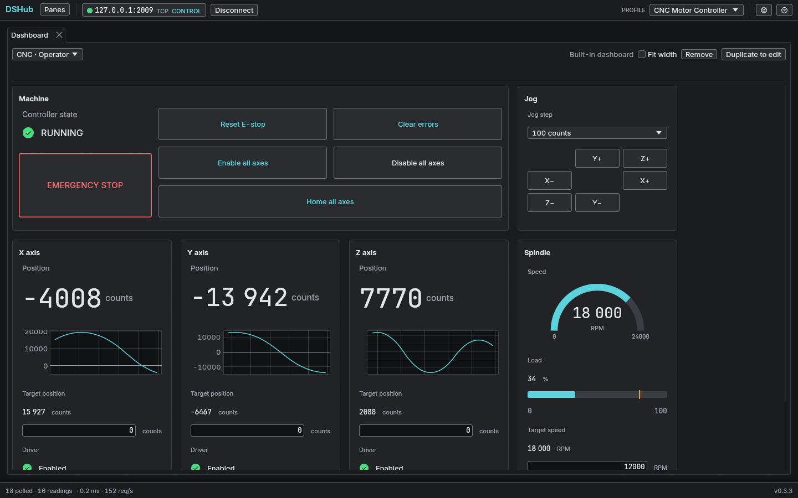
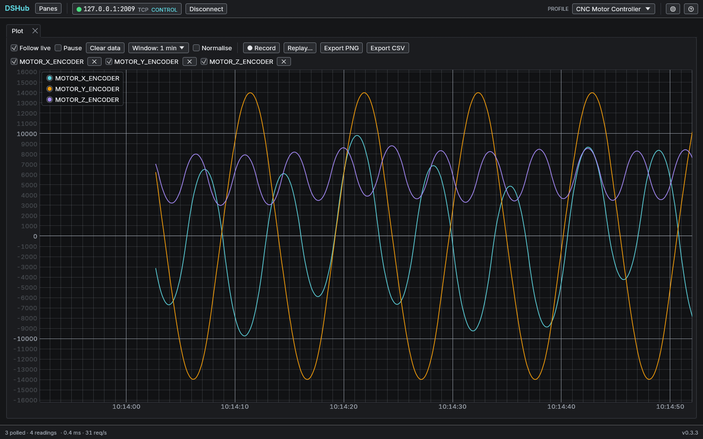
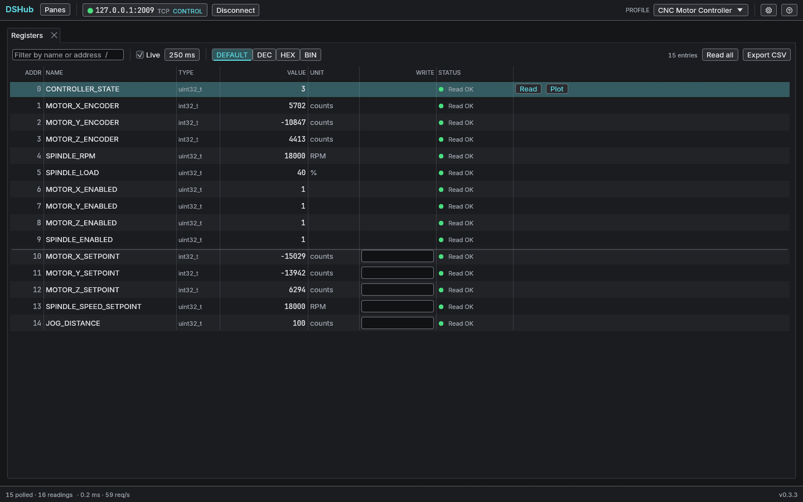
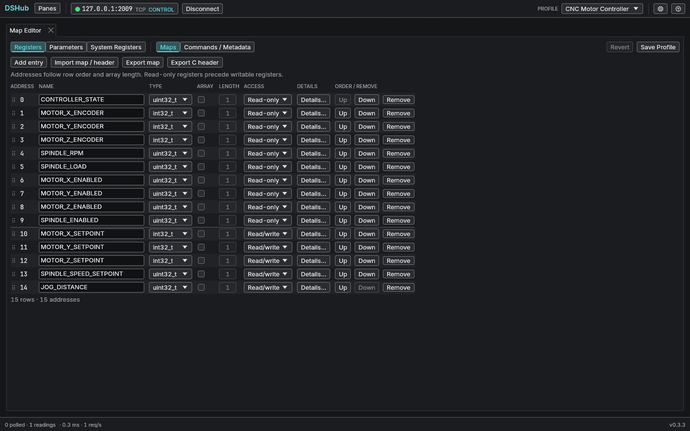
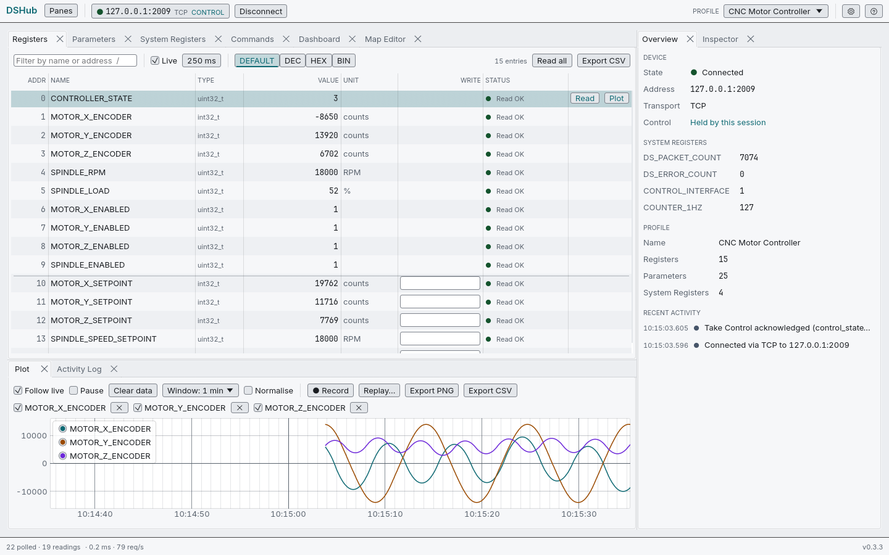

# DSHub

DSHub is a native Rust workstation for monitoring and controlling devices over TCP and UDP. The application uses **egui / eframe** for its desktop interface and **Tokio** for device I/O. The native build has no JavaScript, Node.js, Tauri, WebView, or HTTP server dependency.



## Screenshots

| | |
|---|---|
|  |  |
| CNC operator dashboard | Live plot with crosshair read-out, record and replay |
|  |  |
| Registers, polled live | Map Editor |
|  | |
| Light theme | |

Screenshots were taken against the bundled emulator with simulated CNC motion.

## Run

Install Rust 1.95 or newer, then run from the repository root:

```sh
cargo run --locked
```

For an optimized binary:

```sh
cargo build --locked --release
# Linux / macOS
target/release/dshub
# Windows
# target\release\dshub.exe
```

On Linux the desktop needs OpenGL/EGL, X11 or Wayland, and libxkbcommon. Native file dialogs use the desktop's XDG portal. Debian/Ubuntu build prerequisites:

```sh
sudo apt install build-essential pkg-config libxkbcommon-dev libwayland-dev libegl1-mesa-dev libgl1-mesa-dev
```

Windows uses the MSVC Rust toolchain and Visual Studio C++ build tools. macOS uses the Xcode command-line tools. No WebKit or WebView2 installation is required.

## Work with a device

1. **Scan** for devices, or enter an IP address and select **TCP** or **UDP**.
2. **Connect**, then **Take Control** before sending writes or commands.
3. Select the device's **Profile**. The bundled Default and CNC profiles include maps; CNC also includes command definitions and entry metadata. The Default Profile's **Widget showcase** dashboard shows every widget kind with live library values.
4. Use Registers, Parameters and System Registers to search, read, refresh and inspect values. System registers are read-only. Tables show each entry in its declared type (DEFAULT view) or in decimal, hexadecimal or binary, with engineering units when the map declares scale and offset. Read/write entries have a Write column: type a value and press Enter to send it, or Esc to discard it. The field keeps the keyboard after sending (after the confirmation, if it asks), so the next value can be typed and sent straight away. The field stays outlined while its value is unsent, refused or unacknowledged, or when the device reads back something other than what was sent; hover it for the reason. Dashboard write fields work the same way. Double-click a column divider to fit the column to its contents. **Save values…** in the Registers and Parameters panes reads the entries you tick from the device and saves them to a `.dshub-values` file; **Restore values…** matches a file's entries by name, so a later firmware build with moved addresses still restores. The preview flags entries whose address or type changed (unticked until you tick them, and listed again before sending), skips missing and read-only entries and values the device already holds, and shows each write's outcome.
5. Add traces from a data pane to a Plot. Each Plot lists only its own traces; **Add trace…** offers those other Plots use, and × removes a trace from that Plot alone. Tick **Link time** on Plots that should line up: linked Plots, in any window, share one time axis, window, Pause and Follow live, and hovering one shows the crosshair read-out at the same moment in the others. **Stats** adds a table under the chart with each trace's current value, minimum, maximum, mean, peak-to-peak, standard deviation and sample count over the visible time, computed from every recorded sample; the **Σ** beside each trace in the trace row puts that trace in the table or takes it out. The table fills the pane with columns whose width changes only with the pane, not with the values; values show up to the decimals set in Preferences › Data (default 6), fewer, down to 2, when they would not fit. **Cursors** places two cursors, A and B, to drag over a span: the table then covers that span and adds each trace's value at A, at B and their difference. Linked Plots share their cursors. **Avg** beside a trace draws its moving average over a number of samples, starting once the first full window of samples exists, and its statistics leave out the samples before that; **Show raw** adds the raw samples faintly behind it, and the Stats table lists each line drawn. Plots show a legend at the top left and a crosshair read-out of every trace, pause, export PNG or CSV, and record every reading to CSV for later replay.
6. Configure a Dashboard with readouts, gauges, indicators, controls, tables, alarms, containers, mini-plots and plain text labels on a snapping grid. Dashboard edits are a draft: changed widgets are outlined until **Save** (or **Ctrl+S**), and **Revert** discards them. Built-in dashboards are read-only and updated with DSHub; **Duplicate to edit** makes your own copy. **Fit width** stretches a dashboard across its pane. A Dropdown with a bit mask changes only those bits of a bitmask entry and keeps the rest as last read; it waits for the device to read back an earlier write before offering another.

Press **Ctrl+K** for the command palette, **/** to focus search and **Ctrl +** / **Ctrl −** to scale the interface (also in Preferences). The status bar shows the round-trip time, requests per second, and a warning when polling asks for more than the device answers.

A Profile can name the board types it is written for; DSHub warns when the connected device reports another board. Switching Profile while connected asks first. When a Profile imported from a file has widgets that write or send commands without asking first, DSHub asks whether to make every one of them ask first or to import the Profile as is.

**Network security.** The datastream protocol has no authentication or encryption: any host that can reach a device can read it, write it and take Control. Keep devices on an isolated network or VLAN that only trusted hosts can reach. DSHub marks UDP connections and devices outside a private network as unsecured, and connects to the address a discovery reply came from, flagging replies that claim another. The Activity log can be filtered, paused and decodes the selected packet.

The Main Window owns one device session. Every pane and native daughter window shares that session. Drag tabs to arrange docked panes. Right-click a tab to focus it, duplicate it or move it to a native window. Window titles name the device and Profile. Closing a daughter window returns its panes to the Main Window, and a daughter window closes itself once its last pane is gone. Closing the Main Window exits the app.

Profiles own maps, metadata, commands and dashboards. **Manage Profiles** creates, duplicates, renames, imports, exports and deletes them. The Map Editor keeps changes in a draft until **Save Profile** and outlines every field that differs from the saved Profile. Address or type changes put affected bindings into **Needs review**; those bindings stop reading and writing until explicitly rebound. The review indicator includes bindings in hidden dashboards and nested containers. Profile export/import uses version-one `.dshub-profile` files, including compatibility with dashboards from the former desktop interface.

Workspaces retain named pane arrangements and daughter windows per Profile. Each Profile is stored as its own JSON file in the application data folder; preferences, current layouts, Workspaces, window geometry and plot definitions are saved after changes and on normal exit. Connection sockets, device readings, pending operations and plot samples are never restored. Warnings, errors and crash reports go to a log folder (Preferences > Logging > Open log folder).

## Without hardware

```sh
python3 emulator/dshub_emulator.py
```

Connect to `127.0.0.1`, select the CNC Profile and Take Control. The emulator implements discovery, TCP/UDP, register and parameter operations, CNC commands and simulated motion. See [emulator/README.md](emulator/README.md) and [PROTOCOL.md](PROTOCOL.md).

## Validation

```sh
cargo fmt --check
cargo test --locked
cargo clippy --locked --all-targets --all-features -- -D warnings
# Start the Python emulator; require free TCP 2009 / UDP 2011:
cargo test --locked --test emulator -- --ignored
cargo test --locked --test conformance -- --ignored
```

An opt-in native smoke fixture renders panes against the emulator with real device control and daughter windows: `bash tests/native-smoke.sh` for all eighteen scenes, or name scenes (`bash tests/native-smoke.sh registers editor`). See [the migration notes](docs/egui-migration.md) for details and validation limits.

## Source layout

| Path | Responsibility |
|---|---|
| `src/main.rs` | Native desktop entry point |
| `src/lib.rs` | Library crate shared by the binary, tests and examples |
| `src/ui/` | egui shell, panes, dashboard widgets, review, Profile store and session actor |
| `src/model.rs` | Maps, Profiles, bindings, typed values and persistent domain models |
| `src/profile_compat.rs` | Version-one Profile/dashboard file compatibility |
| `src/map_files.rs` | Firmware header and command-map import/export |
| `src/backend/` | Existing Rust commands, communicator, discovery, polling and protocol types adapted to run without Tauri |
| `src/runtime.rs` | Bounded in-process backend event bridge |
| `src/cnc_dashboard.rs` | Bundled CNC operator dashboards |
| `src/showcase_dashboard.rs` | Default Profile widget showcase |
| `src/dashboard_kit.rs` | Grid layout helpers for bundled and generated dashboards |
| `src/diagnostics.rs` | Rolling log file and crash reports |
| `assets/` | Embedded maps, CNC metadata, fonts and application icon |
| `emulator/` | Python CNC device emulator |
| `tests/emulator.rs` | Real TCP/UDP integration test |
| `tests/conformance.rs` | Replays `tests/protocol-vectors.json` against the emulator |
| `tests/native-smoke.sh` | Native rendering smoke scenes |
| `examples/export_profile.rs` | Portable Profile fixture export / re-export |
| `packaging/` | Linux desktop entry and macOS app bundle |
| `aur-bin/` | Arch Linux `dshub-bin` recipe |

The former Tauri/React application was removed; its sources are kept at the `tauri-reference` tag. The backend's behavior is deliberately preserved for a separate backend review after the native application is accepted.

## Distribution

`./build.sh bin` builds the release binary; `./build.sh pkg` also creates a Debian package on Debian-compatible hosts. `build.bat bin` builds the Windows executable. The GitHub workflow builds and checks Linux, Windows and macOS; version tags publish native archives, a macOS app bundle and the Linux Debian package. Windows binaries are signed and the macOS bundle is signed and notarized when the certificates are configured as repository secrets.

The AUR recipe under `aur-bin/` is published as [`dshub-bin`](https://aur.archlinux.org/packages/dshub-bin). For a new release, bump `pkgver`, run `updpkgsums` once the GitHub release exists, regenerate `.SRCINFO` with `makepkg --printsrcinfo`, and push both files to the AUR repository.

MIT license. See [LICENSE](LICENSE).
